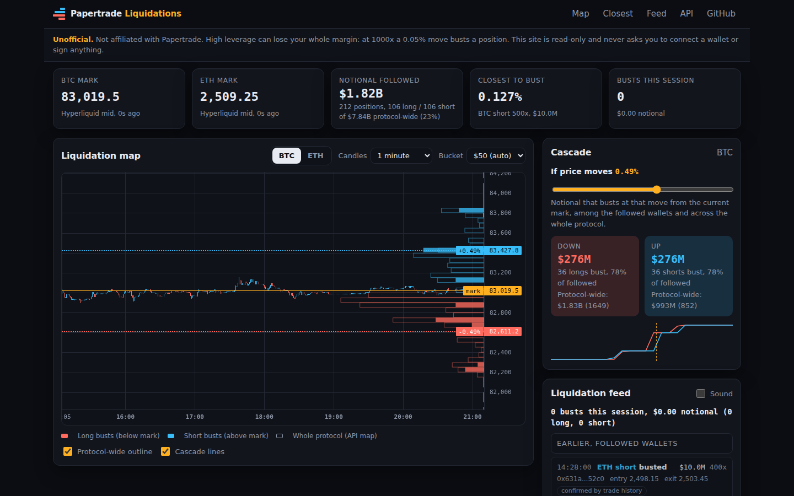

# papertrade-liquidations

[](LICENSE)
[](https://github.com/nirholas/papertrade-liquidations)
[](https://papertrade.xyz)
[](https://github.com/nirholas/papertrade-liquidations/stargazers)
[](https://github.com/nirholas/papertrade-liquidations/commits/main)
[](#the-papertrade-toolkit)

[Live site](https://papertrade-liquidations.pages.dev) · [Issues](https://github.com/nirholas/papertrade-liquidations/issues) · [Discussions](https://github.com/nirholas/papertrade-liquidations/discussions) · [Papertrade](https://papertrade.xyz) · [Toolkit](#the-papertrade-toolkit)

Unofficial live liquidation monitor and heatmap for [Papertrade](https://papertrade.xyz), the fully on-chain 1000x synthetic perps exchange on Hyperliquid's HyperEVM.

> Unofficial, not affiliated with Papertrade, high leverage can lose your whole margin. This app is read-only: it never asks you to connect a wallet or sign anything.

At 1000x a 0.05% move busts a position, so where positions would bust is the most useful signal on the exchange. This app follows the largest open positions, recomputes every bust price with the verified [papertrade-sdk](https://github.com/nirholas/papertrade-sdk) formula, and shows where liquidations cluster, who is closest to bust, and which busts just happened.



The screenshot shows the BTC liquidation map. Candles sit on the left, solid bars on the right edge show bust notional per price bucket (red below the mark for longs, blue above for shorts), hollow bars show the whole-protocol map, and dotted lines mark the cascade move.

## Features

- **Liquidation map** for BTC and ETH: Hyperliquid candles (1m, 5m, 15m, 1h), a side histogram of notional at risk per price bucket, a live mark line, and a bucket-size control with presets and an automatic size. Updates every few seconds, paused while the tab is hidden.
- **Closest to bust** table sorted by distance to bust: side, leverage, margin, notional, entry, bust, distance in % and $, and a link to the wallet in [papertrade-explorer](https://papertrade-explorer.pages.dev). Rows change colour and flash when they cross the 1%, 0.25% and 0.05% thresholds.
- **Liquidation feed** with a session tally (count and notional). A bust is detected three ways: a followed position disappears while the price crossed its bust, the wallet stream reports `liquidated`, or the trade history shows `Liquidated`. Each entry says which source confirmed it. Optional sound, off by default.
- **Cascade** card: notional that would bust if price moved X% (slider, 0.02% to 5%), in both directions, for the followed wallets and protocol-wide, with a curve.
- **Diagnostics**: every bust price is recomputed with the SDK's `liquidationPriceRaw` and compared with the API value. The panel shows the mismatch count (0 across all recorded and live positions), coverage of protocol notional, connection state and data freshness.
- **HTTP API**: `GET /api/heatmap` (see [openapi.json](site/public/openapi.json)).

## Quick start

```sh
npm install ../papertrade-sdk-0.1.0.tgz viem   # until the SDK is on npm
npm install
cp .dev.vars.example site/.dev.vars
npm run dev:site      # http://localhost:8794
npm test
npm run typecheck
```

## Architecture

- `src/` is pure TypeScript shared by the browser and the Pages Function: `positions` (bust recompute and check), `buckets`, `cascade`, `detect` (liquidation detection, price tape, history resolution), `heatmap`, `collect`, `snapshots`, `limiter`, `format`.
- `src/ui/` is the browser layer: `tracker` (wallet streams), `chart` (lightweight-charts with a custom series primitive for the histogram), `table`, `feed`.
- `site/app.ts` wires them together and is bundled by esbuild to `site/public/app.js`.
- `site/functions/api/heatmap.ts` is the Pages Function (Cache API, 10 s). `site/functions/api/papertrade/[[path]].ts` is the same-origin proxy, because the Papertrade API sends no CORS headers on its REST routes.

### Data source

Positions come from the wallets with the most open notional (leaderboard sorted by `currentOpenNotional`), read through the SDK's wallet stream. The top 100 wallets cover roughly three quarters of protocol notional; the diagnostics panel shows the exact coverage against the API's protocol-wide liquidation map, which is drawn as an outline.

The `/state/user/live` endpoint allows only about 10 to 12 new connections per minute per IP and answers 429 beyond that. The browser therefore keeps 6 persistent streams, refreshes the other followed wallets in a rotating sweep, spaces connection starts, and honours `retry-after`. The Pages Function refreshes a few wallets per call and caches per-wallet snapshots, so a full picture builds up over a few calls; the `freshness` field reports snapshot age.

## Environment variables

| Name | Default | Purpose |
| --- | --- | --- |
| `PAPERTRADE_API_URL` | `https://exchange.papertrade.xyz` | Upstream API |
| `HEATMAP_MAX_WALLETS` | `44` | Max wallets per `/api/heatmap` call. Free plan allows 50 subrequests per call; raise to 100 on a paid plan |

Both are optional. See `.dev.vars.example`.

## Deploy

```sh
npm run build:site && cd site && npx wrangler pages deploy
```

## The Papertrade toolkit

Nine open-source building blocks for [Papertrade](https://papertrade.xyz), the fully on-chain 1000x perps exchange on Hyperliquid HyperEVM. Use them together or on their own.

| Project | What it does |
|---|---|
| [papertrade-ai](https://github.com/nirholas/papertrade-ai) | MCP server and CLI: trade Papertrade from Claude, ChatGPT, Cursor and any MCP client |
| [papertrade-sdk](https://github.com/nirholas/papertrade-sdk) | Typed API client, live account stream, EIP-712 signing and verified settlement math. |
| [papertrade-terminal](https://github.com/nirholas/papertrade-terminal) | Non-custodial web trading terminal with charts, order ticket, funding and swaps. |
| [papertrade-analytics](https://github.com/nirholas/papertrade-analytics) | DefiLlama-style dashboard and JSON API: TVL, volume, OI, PAPER economics. |
| [papertrade-explorer](https://github.com/nirholas/papertrade-explorer) | Linkable wallet pages, decoded transactions and a live leaderboard. |
| **papertrade-liquidations** (this repo) | Liquidation map and closest-to-bust feed, recomputed with the verified formula. |
| [papertrade-yield](https://github.com/nirholas/papertrade-yield) | PAPER staking dashboard with realized USDC yield and wallet-signed actions. |
| [papertrade-alerts](https://github.com/nirholas/papertrade-alerts) | Know before the liquidation: Telegram, Discord and webhook alerts. |
| [papertrade-copytrade](https://github.com/nirholas/papertrade-copytrade) | Guard-railed copy-trading CLI. Dry run by default. |
| [papertrade-x402](https://github.com/nirholas/papertrade-x402) | Pay-per-call intelligence API for AI agents, paid in USDC on Solana or Base. |

## Contributing and support

- Found a bug or want a feature? [Open an issue](https://github.com/nirholas/papertrade-liquidations/issues/new/choose).
- Questions and show-and-tell: [Discussions](https://github.com/nirholas/papertrade-liquidations/discussions).
- Pull requests are welcome, see [CONTRIBUTING.md](CONTRIBUTING.md). Security reports go through [SECURITY.md](SECURITY.md).
- If this saved you time, a star helps other Papertrade traders and builders find it.

Built by [three.ws](https://three.ws).

## Disclaimer

Unofficial, not affiliated with Papertrade, high leverage can lose your whole margin. Not financial advice. Liquidation figures cover the followed wallets and are an estimate of the whole protocol.

## License

Apache-2.0, 2026, nirholas.
